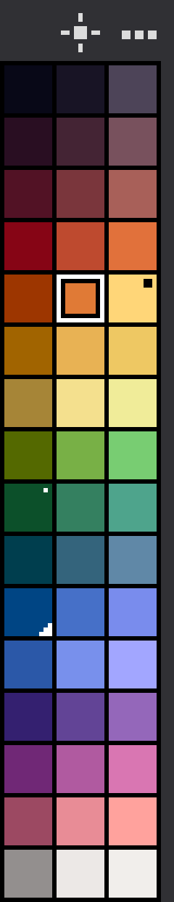

# Palette Trio

**Shade families for your Aseprite palette, plus non-destructive pixel-art lighting.**

Palette Trio is a small extension for [Aseprite](https://www.aseprite.org/). It reads the colors of your sprite's **native palette** and shows each one as a row with generated shades:

- 3 shades (default): **SHADOW | BASE | LIGHT**
- 5 shades: **DEEP | SHADOW | BASE | LIGHT | BRIGHT**

Click a swatch to paint with it. Change a color in Aseprite's own palette and its family follows. **Palette Trio Light** then shades flat, base-colored artwork using exactly those families, so the result stays on your palette.


*Top: flat base colors. Bottom: the same sprites after Palette Trio Light (sphere, bevelled box, cylinder). Every shaded color comes from the Palette Trio families.*


| 3 shades | 5 shades |
|---|---|
|  |  |

> The images above are produced by the project's own scripts (`scripts/make_demo.lua`, `tests/render_preview.lua`) from the real shade generation and the real Light engine. They are renders of the output and of the panel's swatch grid, not screenshots of the Aseprite window.

## Beta status, and please read this

Palette Trio is a **public beta (0.3)**. It has been tested by hand on macOS with Aseprite 1.3.17 and by automated tests (see [Development](#development)). Windows and Linux are untested. Please report problems on the [issue tracker](https://github.com/andmkv/asetrio/issues).

> ### ⚠ Light: "Replace source" is not safe across restarts
>
> Light has two outputs. **New layer** (the default) never touches your art. **Replace source** overwrites the pixels of the source layer in the current frame.
>
> To avoid shading an already-shaded image, Palette Trio remembers the original pixels of that cel, **but only while Aseprite stays open**. The original is *not* saved in the `.aseprite` file. After you restart Aseprite, reopen the file, or edit the layer, the shaded pixels become the new source.
>
> - **Undo** restores the pixels, as long as the undo history exists.
> - Before using **Replace source** on anything you care about, **duplicate the unshaded layer** (or save a copy of the file).
> - For everything else, use **New layer**.

## Requirements

- Aseprite **1.3.15 or newer** (automated tests run on 1.3.17).
- No other dependencies.

## Install

1. Download `Palette-Trio.aseprite-extension` from the [Releases](https://github.com/andmkv/asetrio/releases) page (or [build it yourself](#development)).
2. In Aseprite open **Edit > Preferences > Extensions > Add Extension** and choose the file. Double-clicking the file in Finder or Explorer also works.
3. Open **View > Palette Trio**.

If you have an earlier development build of Palette Trio installed, remove it first in the Extensions list. Your saved families are kept, because they live in your sprite files.

## Quick start

1. Open a sprite and set up its colors in Aseprite's palette.
2. **View > Palette Trio**. Every palette color is now a row with its shades.
3. **Click** a swatch to paint with it, **right-click** to set the background color, **double-click** to edit it.
4. Click the **sun** icon to open Light.

Opening Palette Trio never changes your palette or your pixels.

## The panel

A narrow column of square swatches that looks and sizes like Aseprite's own palette (it follows **Preferences > Color bar** box size and the entry separator). Two icons sit above the grid: **Light** (sun) and the **...** menu.

| Action | Result |
|---|---|
| Click a swatch | set the foreground (paint) color |
| Right-click a swatch | set the background color |
| Double-click a swatch | edit it |
| Mouse wheel | scroll through the families |
| **sun** icon | open Palette Trio Light |
| **...** icon | open the menu |

Markers on swatches:

- Two-tone frame inside the cell: the selected swatch.
- Triangle in the top-left corner: the current foreground color. Bottom-right: the current background color.
- Small 2×2 square in the top-right corner: a shade you edited by hand. Single corner pixel: a pinned automatic shade.
- Short tick at the bottom of a BASE swatch: the base was edited in Palette Trio, or it is a custom color that is not in the palette.
- Orange edge on a row: that family's color was removed from the palette.
- Dot on the **...** icon: something needs attention. The first line of the menu explains it.

The window can be resized freely. Cells keep the native palette size and the grid scrolls. Palette Trio never resizes its own windows, and it remembers the window position and size.

### The ... menu

- **3 shades** / **5 shades**
- **Choose palette colors...**, **Use full document palette**, **Remove missing colors**
- **Add current color**, **Import colors from artwork...**, **Import palette file...**
- **Edit selected swatch...**, **Shade settings...**, **Write to sprite palette...**, **Export palette...**
- **Light...**
- **About Palette Trio...**

Aseprite's script API has no native popup menu, so the menu is a small window that opens beside the panel. It closes after you pick an item, press Esc, or click **...** again.

## Where the colors come from

**By default: the whole native palette, in palette order.** A sprite with a 32-color palette shows 32 families. The colors used in the artwork do not matter.

- Fully transparent entries and an indexed sprite's transparent index are skipped. Identical colors become one family.
- Colors you authored are never filtered out for "looking like a shade". The only colors excluded automatically are shades that Palette Trio itself wrote into the palette with **Write to sprite palette**, which it records when it writes them.
- When you edit the palette, the families follow. A changed color updates its family in place and keeps its name, order and hand-edited shades. A new color adds a family. A deleted color removes its family if you never edited it, and otherwise keeps it marked in orange until you choose **Remove missing colors**.
- A base you edited inside Palette Trio is never overwritten by palette changes.

Optional sources, all in the menu:

| Menu item | What it does |
|---|---|
| **Choose palette colors...** | Pick which palette colors become families. Exclusions are saved and stay excluded when the palette changes. |
| **Use full document palette** | Bring back every palette color. Custom colors and edits are kept. |
| **Add current color** | Add the current foreground color as a custom family. |
| **Import colors from artwork...** | Choose colors used in the image (existing bases and their shades are left out). They become custom families. |
| **Import palette file...** | Choose colors from a `.gpl`, `.pal`, `.act`, `.col`, `.hex`, `.png` or `.aseprite` file. |

## Editing a swatch

Double-click a swatch (or **...** > **Edit selected swatch...**):

- Color picker and HEX field, **Use current color**.
- Editing a **BASE** regenerates the automatic shades of that family. **Revert base** returns to the palette color.
- Editing a shade makes it a **manual** shade that stays when the base changes. **Pin** keeps an automatic shade as it is. **Unpin** / **Restore auto** goes back to automatic.
- Name the family, move it, or remove it (this also excludes a palette color so it does not come back).

**Shade settings...** controls shadow depth, highlight lift, cool shadows and warm highlights. Shades are generated in OKLCH with gamut mapping.

## Writing to the palette

Nothing changes the native palette except **Write to sprite palette...**, and it always asks first.

- **RGB sprites:** *Append* adds only the missing colors after the existing ones. *Replace* makes the palette exactly the generated colors.
- **Indexed sprites:** append only. Existing entries and the transparent index never change.
- Pixels are never modified. Each write is one undo step.

## Palette Trio Light

Light shades flat artwork with the Palette Trio families. Open it from the **sun** icon.

1. Paint your object with base colors (or with any family's shades).
2. Choose the **Layer**.
3. **Family**: leave it on **Auto (detect)**, or choose one. Auto finds the family that dominates the layer; any shade of a family counts. To choose by eye, click **Pick** and then click the object in the preview (right-click on the preview also picks). The paint color selected in Aseprite is never used.
4. Choose a **Shape** (Round, Box/Bevel, Cylinder, Contour), drag the light marker in the preview, and adjust **Elevation**, **Contrast**, **Shades** (3 or 5) and **Dither**.
5. Choose the **Output** and press the button.

| Output | Behavior |
|---|---|
| **New layer** (default) | Creates or updates a `Palette Trio Light - <layer>` layer for the current frame. Your source layer is untouched. |
| **Replace source** | Asks first, then overwrites only the source cel in the current frame, as one undo step. See [the warning above](#beta-status-and-please-read-this). |

Details:

- Only pixels that belong to a family are shaded. Transparent pixels, unknown colors and the colors listed under *Keep colors* stay as they are. Alpha is kept.
- Options (in the dialog): keep 1-pixel outlines, shade separate objects separately.
- Light works on the current frame and on RGB sprites only. There are no cast shadows.
- The result is a stylized 2.5D shading from the object's silhouette, so it works best on simple shapes. Large layers can take a moment to preview.

## Saving and undo

- Families, exclusions, pins, names and settings are stored in the sprite file itself. Each change is one undo step named "Palette Trio: ...".
- **PNG, GIF, JPG and other flat formats cannot store this data.** Palette Trio warns you the first time. Save as `.aseprite` to keep your pins, names and exclusions.
- If saving the data fails, you see **Not saved** and an explanation.
- Data from an unknown newer version of the format is never overwritten.

## Known limitations

- Beta software, hand-tested mainly on macOS. Windows and Linux are untested.
- **Replace source** keeps the original only for the current session (see above).
- Aseprite 1.3.17 can leave stale pixels when a script window is resized by hand. That is an Aseprite redraw issue; Palette Trio avoids triggering it but cannot fix it. Moving or resizing the window again repaints it.
- Running the menu command again reuses the open window, but Aseprite's API cannot raise it above other windows.
- Light is RGB only, current frame only, and approximates 3D from a silhouette.

## Development

```sh
python3 scripts/build.py     # builds dist/Palette-Trio.aseprite-extension
./tests/run.sh               # all automated suites
```

The tests run inside Aseprite itself (batch mode, Aseprite's embedded Lua 5.4). Set `ASEPRITE=/path/to/aseprite` if it is not in the default macOS location. See [docs/TESTING.md](docs/TESTING.md) for what each suite covers, how to regenerate the README images, and the manual checklist.

```
main.lua            plugin entry point (one command: View > Palette Trio)
src/                model, color, native-palette sync, panel, menu, dialogs, Light engine and UI
tests/              unit, integration, dialog-smoke and render tests
scripts/            build script and README image generator
docs/               images, testing notes, design notes
```

Contributions and bug reports are welcome. Please include your Aseprite version and operating system.

## License and credits

[MIT](LICENSE) © 2026 Andrey Makeev.

Made by Andrey Makeev at [Smallhall.net - More apps and games](https://smallhall.net).
